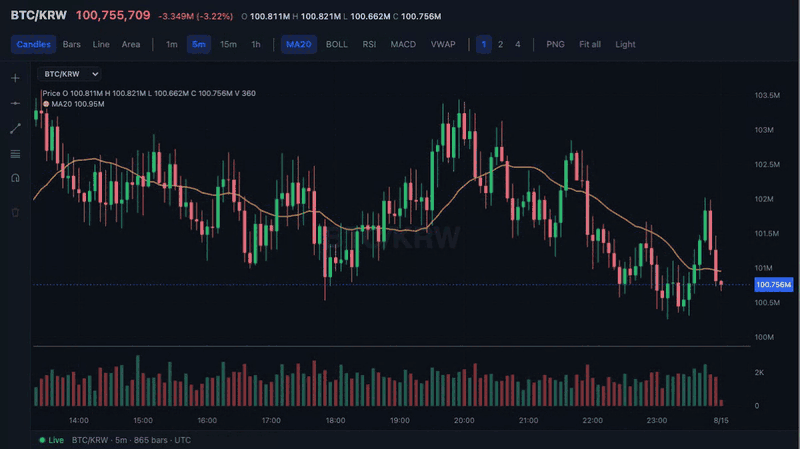

# @finchart

**A composable financial chart engine for TypeScript apps.** Candles,
indicators, drawing tools, and live feeds on a DOM-free core, with a browser
shell and a React wrapper on top when you need them.

[](https://www.npmjs.com/package/@finchart/core)
[](LICENSE)

**[Documentation](https://finchart.fseller.dev)** ·
**[Live showcase](https://finchart.fseller.dev/showcase)** ·
**[Examples](https://finchart.fseller.dev/examples/)**



> **Status: alpha.** The public API still changes — during 0.x, minor
> releases can carry breaking changes.

## Quick start

```bash
pnpm add @finchart/core @finchart/dom
```

```html
<div id="chart" style="height: 400px"></div>
```

```ts
import { candleSeries } from "@finchart/core";
import { PlotBuilder, browserDeps } from "@finchart/dom";

const plot = PlotBuilder.create(browserDeps(), candleSeries())
  .addDataPoints([
    { x: 0, open: 100, high: 108, low: 98, close: 106 },
    { x: 1, open: 106, high: 112, low: 104, close: 109 },
    { x: 2, open: 109, high: 111, low: 101, close: 103 },
  ])
  .setSize(800, 400)
  .build(document.getElementById("chart")!);
```

Drag to pan, scroll to zoom. Data must be in ascending x order, and the
container needs a height: the canvas is layered over it, so an empty `<div>`
stays 0 px tall. To add indicators or stream updates, register the series with
`addSeries` and keep the handle it returns — the
[getting started guide](https://finchart.fseller.dev/guide/getting-started)
walks through it.

### React

```bash
pnpm add @finchart/core @finchart/dom @finchart/react
```

```tsx
import { candleSeries } from "@finchart/core";
import type { OHLC } from "@finchart/core";
import { browserDeps } from "@finchart/dom";
import { ChartContainer, ChartPane, ChartSeries, XAxis, YAxis } from "@finchart/react";
import { useMemo } from "react";

function Chart({ data }: { data: OHLC[] }) {
  const deps = useMemo(() => browserDeps(), []);
  return (
    <ChartContainer deps={deps} data={data} width={800} height={400}>
      <XAxis />
      <ChartPane>
        <YAxis />
        <ChartSeries series={candleSeries()} />
      </ChartPane>
    </ChartContainer>
  );
}
```

Child components render no DOM; they register with the chart. Add another
`<ChartPane>` to put an indicator below the price — the
[`@finchart/react` README](packages/react) shows one. In Next.js the chart
lives in one client file — see
[Next.js and React apps](https://finchart.fseller.dev/guide/nextjs).

## What you get

- **Series** — candles, OHLC bars, line, step line, area, baseline, and
  volume histogram, plus a two-method contract for your own.
- **35 indicators** (`@finchart/indicators`) — MA, MACD, Bollinger Bands, RSI,
  Ichimoku, VWAP, SuperTrend and more, plus Heikin-Ashi, Renko, Line
  Break, Kagi, and Point & Figure derivations and a volume profile.
- **Drawing tools** (`@finchart/tools`) — horizontal and vertical lines,
  trend lines, rays, Fibonacci, channels, pitchforks, measures, and shapes,
  with magnet snapping. Drawings are plain data you can save and restore.
- **Live data** — `updateLast` for ticks, `conflated` to fold a busy feed into
  one update per frame, and `infiniteHistory` to load older bars as you scroll.
  See the [live feed guide](https://finchart.fseller.dev/guide/live-feed).
- **Interaction** — pan, zoom, pinch, axis drag, keyboard, double-click
  reset, and kinetic scrolling, each one optional, plus synced x ranges across
  charts.
- **Decorations** — crosshair, tooltip, legend, price line with an axis
  badge, markers, watermark, and range highlight.
- **Panes and time** — stacked or overlaid panes, a bar-index x-axis with no
  weekend gaps, and calendar-aware time ticks in any time zone, using only
  `Intl`.
- **Rendering** — high-DPI canvases, one render per frame, and PNG export
  with `takeScreenshot`.

## Why @finchart

**Test chart output without a browser.** `createPlotModel` emits draw
commands, so a unit test can check chart geometry with no DOM and no
screenshot:

```ts
import { createPlotModel, lineSeries } from "@finchart/core/headless";

// Turn showGrid off — otherwise the grid is drawLine too, so the first
// command you get back is a grid line, not your series.
const model = createPlotModel({
  size,
  series: { series: lineSeries(), data },
  config: { showGrid: false },
});
const lines = model.commands().filter((c) => c.type === "drawLine");
expect(lines[0].points).toHaveLength(data.length);
```

The same headless core runs on servers and in workers: `@finchart/core` has
no dependencies and needs no DOM, at runtime or in its types.

**Extend it the way the built-ins do.** Indicators and drawing tools ship as
separate packages built only on core's public contracts — computed nodes, the
plugin API, and the input stack. Your own indicator or tool gets the same
doors. See
[Building your own indicator](https://finchart.fseller.dev/guide/extensions)
and [Architecture](https://finchart.fseller.dev/guide/architecture).

**Pay only for what you wire.** `browserDeps()` sets up everything;
`createPlotDeps` takes only the renderers and interactions you use. The
[bundle guide](https://finchart.fseller.dev/guide/explicit-wiring) lists
gzipped budgets that CI enforces.

**Restyle with CSS.** Colors come from CSS variables on the container:

```css
.chart {
  --chart-candle-up: #16a34a;
  --chart-candle-down: #dc2626;
}
```

The full list and dark-mode wiring are in the
[theming guide](https://finchart.fseller.dev/guide/theme).

## Packages

| Package | What it is |
|---|---|
| [`@finchart/core`](packages/core) | Chart engine: series, panes, scales, interaction, draw commands. No DOM. |
| [`@finchart/dom`](packages/dom) | Browser shell: canvas rendering and pointer and keyboard input. |
| [`@finchart/react`](packages/react) | React components and hooks. |
| [`@finchart/indicators`](packages/indicators) | Technical indicators and candle derivations. |
| [`@finchart/tools`](packages/tools) | Interactive drawing tools. |

All five ship as one fixed version, and the other four each declare a
matching `@finchart/core` as a peer, so npm refuses a mismatched install
and pnpm warns about it.

## Support matrix

| | Minimum | Why |
|---|---|---|
| Node | **20.19** | The headless path (SSR, workers, tests); CI runs this floor |
| Browsers | **Chrome 98 · Edge 98 · Firefox 94 · Safari 15.4** | `structuredClone`, `Object.hasOwn`, `Array.prototype.at` |
| React | **18** | Peer range; CI runs 18 and 19 |

No polyfills ship. CI runs the browser end-to-end suite in current Chromium,
Firefox, and WebKit; the browser versions above are API floors, not versions
that suite runs.

## Development

```bash
git clone https://github.com/FutureSeller/finchart.git charts && cd charts
pnpm install
pnpm test          # unit tests across the workspace
pnpm build
pnpm dev           # package watch builds plus the examples, demos, and docs apps
```

Working on the repository needs Node 24.21+ and pnpm 12. Start with the
[developer documentation](docs/README.md); see
[CONTRIBUTING.md](CONTRIBUTING.md) for pull requests and changesets, and
[SECURITY.md](SECURITY.md) for private vulnerability reports.

## License

[MIT](LICENSE)
